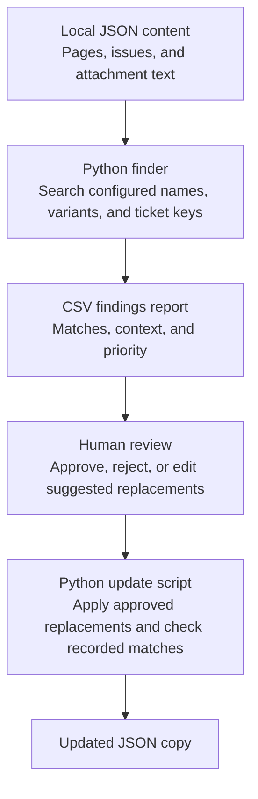

# Outdated reference finder

A Python tool that identifies potential references to a retired company name in exported wiki pages, tickets, and attachment text. It produces a prioritized CSV report for human review.

> **About this demo:** The company, product, ticket keys, and content are fictional and were created for this portfolio. The approach is based on my professional experience. The code and sample data were written from scratch and contain no employer content.

## Why this exists

When a company renames itself, the old name can linger in documentation, ticket descriptions, and attached files. These outdated references can confuse readers and undermine trust in the documentation. Finding them manually across hundreds of pages is slow, while a plain-text search returns matches that may be unrelated.

The tool finds and prioritizes potential matches. A reviewer decides which ones need changes.

## What it does

1. **Find.** `find_outdated_refs.py` searches page titles, page bodies, and attachment text for:
   - the old company name (`Orbitwell Systems`);
   - variants (`Orbitwell`, `OrbSys`, `Orbit-Well`), matched case-insensitively;
   - legacy ticket keys with the configured prefix, such as `OWS-142`;
   - ambiguous phrases that may or may not refer to the old name, such as `Orbit Systems`.
2. **Report.** It writes a CSV sorted by priority, source type, and then newest first.
3. **Review.** A reviewer opens the CSV and enters `approve` or `reject` in each row's `review_decision` column.
4. **Apply.** `apply_approved.py` applies approved replacements to a copy of the content. The documented workflow uses a separate output file; see [Safety checks](#safety-checks).

## Workflow

The diagram below shows how the **public demo** works. It uses local JSON data rather than connecting to live Jira or Confluence. In the original professional project, REST APIs were used to access content.



## Quick start

The scripts use only the Python standard library, so there is nothing to install.

Run the finder from the project directory:

```bash
python3 find_outdated_refs.py --input sample_content/pages.json --output findings.csv
```

Expected output:

```text
Scanned 7 pages; 6 contain possible references.
Wrote 15 findings to findings.csv
By priority: high=6, low=4, medium=5
By match type: ambiguous=1, ambiguous-likely-generic=1, old-name=5, ticket-reference=3, variant=5
```

The script currently uses `pages` as a generic label in its status message. The sample JSON contains seven content records: five Confluence pages and two Jira issues, with attachment text on some records.

Open `findings.csv` in a spreadsheet. For each row you accept, type `approve` in the `review_decision` column. Type `reject` for a match you have reviewed and decided not to change, or leave the decision blank if it still needs review. You can edit `suggested_replacement` or add a note in `reviewer_notes`.

Apply approved replacements to a separate output file:

```bash
python3 apply_approved.py --input sample_content/pages.json --reviewed findings.csv --output updated_pages.json
```

An example report generated from the sample content is in `examples/findings.csv`.

## Files

| File | Purpose |
|---|---|
| `find_outdated_refs.py` | Searches content and writes the findings CSV. |
| `apply_approved.py` | Applies approved replacements to a copy of the content. |
| `refs_common.py` | Helper functions shared by both scripts. |
| `config.json` | Configures the new name, old names, variants, ticket prefix, ambiguous phrases, and generic-context terms. |
| `sample_content/pages.json` | Seven fictional content records from Confluence and Jira, including sample attachment text. |
| `examples/findings.csv` | Report generated from the sample content. |

## The report columns

| Column | Meaning |
|---|---|
| `finding_id` | Sequential identifier for a finding in this report. It is not a permanent identifier across report runs. |
| `priority` | `high`, `medium`, or `low` (see [How priority is assigned](#how-priority-is-assigned)). |
| `source_type`, `page_id`, `title`, `last_modified` | Identify the source containing the match and provide context for review. |
| `audience` | Indicates whether the content is public or internal; this affects priority. |
| `location` | `title`, `body`, or `attachment:<filename>`. |
| `start` | Character offset of the match within that location. |
| `match_type` | `old-name`, `variant`, `ticket-reference`, `ambiguous`, or `ambiguous-likely-generic`. |
| `matched_text`, `context` | The match and approximately 40 characters on each side. |
| `suggested_replacement` | The configured new name for old names and variants. Empty for other match types unless a reviewer enters a replacement. |
| `review_decision`, `reviewer_notes` | Fields the reviewer fills in. Use `approve`, `reject`, or leave the decision blank. |

## How priority is assigned

These rules are illustrative and can be adjusted for other content.

| Match type | Priority | Reason |
|---|---|---|
| Old name or variant in public content | High | Customers can see it. |
| Old name or variant in internal content | Medium | Less visible, but still potentially confusing. |
| Ambiguous phrase | Medium | A reviewer needs to decide whether it refers to the old name. |
| Ambiguous phrase with generic-context terms nearby | Low | The match is more likely to be unrelated. |
| Legacy ticket key | Low | The key is a historical identifier and usually should not be renamed. A reviewer may choose to add context instead. |

## Handling false positives

The old name contains the common word `Systems`. Searching for that word alone would flag unrelated content about operating systems or embedded systems. The tool avoids this in two ways:

- **It searches configured names and phrases, not the common word alone.** In the sample content, `CONF-1004` discusses operating systems and embedded systems but produces no findings.
- **It classifies ambiguous phrases separately.** `Orbit Systems` could refer to the old name or to a generic engineering concept. If a configured term from `generic_context_words` appears in the surrounding context snippet, the match is classified as `ambiguous-likely-generic`. Otherwise, it remains `ambiguous` for a reviewer to assess. In the sample, `Orbit Systems Engineering team` remains `ambiguous`, while `orbit systems dashboards for satellite trajectory data` is classified as `ambiguous-likely-generic`.

## Safety checks

- **Use separate input and output paths.** The example writes to `updated_pages.json`, leaving `sample_content/pages.json` unchanged. The current script does not reject identical `--input` and `--output` paths, so using the same path can overwrite the input file. Always specify a different output path.
- **Only approved rows with a replacement are applied.** A row marked `approve` with an empty `suggested_replacement` is ignored. A reviewer can enter a replacement in that column to apply one.
- **Stale offsets are skipped.** Each change is applied only if the text at the recorded offset still equals `matched_text`. If the content has changed since the report was generated, a mismatch is skipped and reported rather than guessed. Changes within the same text field are processed from the highest offset to the lowest so earlier replacements do not shift the offsets of later matches.

## Limitations

- **Replacement does not fix grammar.** The sample page `CONF-1001` says “an ORBITWELL account key.” After replacement, it reads “an Nimbra account key.” A reviewer must correct the article; the tool cannot finish the editorial review on its own.
- **No live connection.** The demo reads a local JSON file and does not connect to live Jira or Confluence. A real integration would need to fetch the content through their APIs before scanning it.
- **Plain-text attachment content only.** The sample data includes `.txt` and `.csv` attachments whose text is already present in the JSON. The demo does not extract text from actual attachment files. PDF and Office-file extraction would require additional code and libraries.
- **Name and variant matching is case-insensitive.** For example, `ORBITWELL` and `Orbitwell` both match. Ticket-reference matching uses the configured prefix as written. Review replacements if capitalization matters in the target content.
- **No cross-source deduplication.** The tool does not identify duplicate content repeated across pages or attachments.

## Testing

I ran both scripts on Ubuntu 26.04.1 LTS with Python 3.14.4, using the sample content. The checks included:

- the finder produces the 15 findings in `examples/findings.csv`;
- `CONF-1004` produces no findings;
- approving nine rows, rejecting one, and leaving the rest blank changes only the nine approved rows;
- with a separate output path, the input file remains byte-for-byte unchanged after applying;
- rescanning the corrected copy no longer reports the specific approved occurrences that were replaced;
- editing a page after the scan causes affected rows to be skipped.

The demo has not been tested against live Jira or Confluence, PDF or Office attachments, or large datasets. The current script also does not prevent the input and output paths from being identical; use separate paths as shown in the quick-start command.
